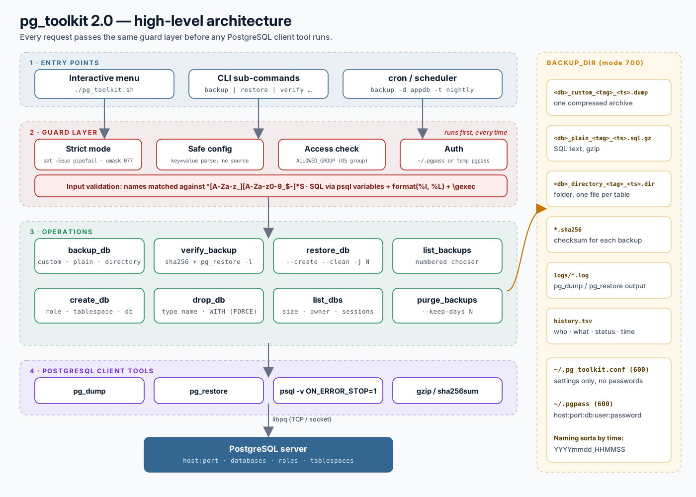

# 🐘 pg_toolkit

**A secure PostgreSQL backup, restore and admin toolkit in Bash.** Interactive menu for daily DBA work, plus CLI commands for cron.



## Features

- **Three backup formats:** custom (`-Fc`), plain SQL (gzip) and directory (`-Fd`, parallel)
- **Verified restores:** a SHA-256 checksum is written after every backup, and checksum + `pg_restore -l` / `gzip -t` are checked before any restore
- **Safe restore:** `--create`, `--clean --if-exists`, parallel `-j`; plain restores stop on the first error and roll back
- **Database admin:** create role + tablespace + database, list sizes and sessions, guarded drop (type the name, offers a backup first, refuses system databases)
- **Housekeeping:** age-based retention, with a preview before deleting
- **Audit trail:** every result (success or failure) is recorded in `history.tsv`
- **Secure by design:** authentication via `~/.pgpass`, no `eval`, no `PGPASSWORD`, SQL built with `format(%I, %L)`, owner-only files (`umask 077`)

## Quick start

```bash
curl -LO https://raw.githubusercontent.com/tamilselvanshree/pg_toolkit/main/pg_toolkit.sh
chmod 700 pg_toolkit.sh

echo 'localhost:5432:*:postgres:YourStrongPassword' >> ~/.pgpass
chmod 600 ~/.pgpass

./pg_toolkit.sh                 # interactive menu
./pg_toolkit.sh --help          # all commands
```

## Commands

```text
backup       -d DB [-f custom|plain|directory] [-t TAG] [-j JOBS]
verify       --file PATH
restore      --file PATH --target DB [--create] [--clean] [-j JOBS]
list-backups [-d DB]
list-dbs
create-db    -d DB --owner ROLE [--tablespace NAME [--location DIR]]
drop-db      -d DB [--yes]
purge        [--keep-days N] [--yes]
```

Connection: `-h HOST -p PORT -U USER`, or `PGHOST` / `PGPORT` / `PGUSER`, or `~/.pg_toolkit.conf` (see `pg_toolkit.conf.example`).

### Cron example

```cron
15 1 * * *  NO_COLOR=1 /home/postgres/pg_toolkit.sh backup -d appdb -f custom -t nightly >> /pgbackup/dumps/logs/cron.log 2>&1
0 5 * * *   NO_COLOR=1 /home/postgres/pg_toolkit.sh purge --keep-days 14 --yes >> /pgbackup/dumps/logs/cron.log 2>&1
```

## Requirements

bash 4+, PostgreSQL client tools (`psql`, `pg_dump`, `pg_restore`) of the same or newer major version than the server, gzip, sha256sum. Tested on PostgreSQL 16 / Ubuntu 24.04.

These are **logical** backups. For point-in-time recovery, use `pg_basebackup` + WAL archiving or pgBackRest alongside this tool.

> Always test on a non-production system first.

## Documentation

- Full walkthrough: [techstaradmin.blogspot.com](https://techstaradmin.blogspot.com)
- Download: [pg_toolkit.sh (raw)](https://raw.githubusercontent.com/tamilselvanshree/pg_toolkit/main/pg_toolkit.sh)
- Code review and v1.1 → 2.0 changes: [REVIEW.md](REVIEW.md)

## License

[MIT](LICENSE) © 2023–2026 Tamilselvan Perumal
